<div align="center">

# 🔷 InsightForge – AI Data Analyst

### Transforming Raw Data into Actionable Intelligence

An AI-powered, end-to-end data analytics platform that integrates automated data preparation, natural language querying, interactive visualization, machine learning and intelligent reporting into a unified analytics workspace.


**Explore • Clean • Analyze • Visualize • Predict • Report**

</div>

---

## 📌 Project Overview

InsightForge is an intelligent data analytics application designed to simplify the complete data analysis lifecycle.

The platform enables users to connect datasets from multiple sources, identify data quality issues, perform automated cleaning, ask questions in natural language, generate interactive charts, train predictive models and export analytical reports.

By combining traditional data analytics with Generative AI and Machine Learning, InsightForge makes data exploration more accessible to both technical and non-technical users.

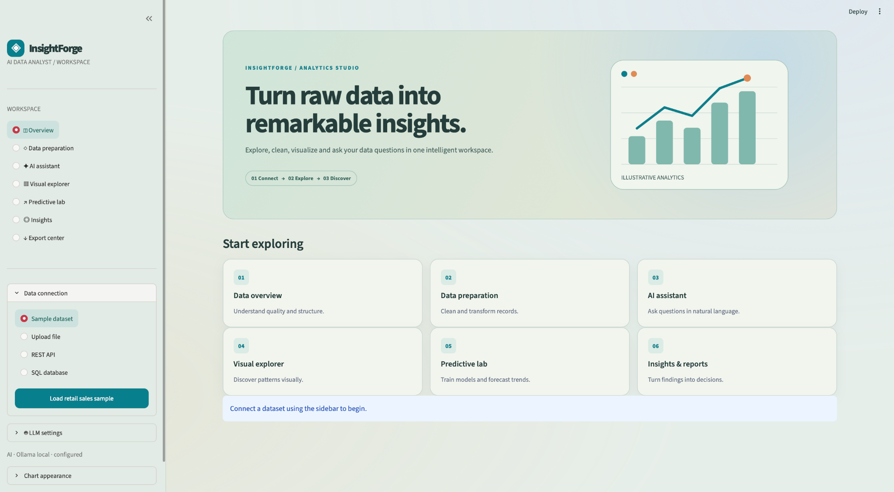

---

## 🎯 Project Objectives

- Simplify complex data analytics workflows.
- Automate repetitive data preparation tasks.
- Enable natural language interaction with structured datasets.
- Generate SQL queries using Large Language Models.
- Provide interactive and customizable data visualizations.
- Integrate machine learning and predictive analytics.
- Generate statistical insights and downloadable reports.
- Support local AI execution through Ollama.

---

## 🚀 Key Features

| Feature | Description |
|---|---|
| Multi-Source Data Ingestion | Connect CSV, TSV, Excel, JSON, REST APIs and SQL databases. |
| Data Profiling | Identify missing values, duplicates, outliers and column characteristics. |
| Automated Data Cleaning | Handle missing values, duplicates, inconsistent formatting and outliers. |
| Data Quality Assessment | Measure and compare data quality before and after cleaning. |
| AI Data Assistant | Ask analytical questions using plain English. |
| Natural Language to SQL | Convert user questions into executable SQL queries. |
| SQL Safety Validation | Validate generated SQL before execution. |
| Interactive Visualization | Generate automatic and user-configured charts. |
| Chart Customization | Personalize chart colors and visualization appearance. |
| Automated Machine Learning | Train and compare predictive models. |
| Time Series Forecasting | Estimate future trends from historical data. |
| Clustering | Identify meaningful groups within datasets. |
| Statistical Insights | Discover correlations, distributions and business patterns. |
| Intelligent Reporting | Export analytical results in HTML, Excel and PDF formats. |
| Local AI Integration | Run supported language models locally using Ollama. |

---

## 📸 Application Screenshots

### 01 — Homepage

A centralized analytics workspace with intuitive navigation and multiple data connection options.


### 02 — Dataset Intelligence

Explore dataset structure, data quality scores, missing values, duplicate records and outliers.

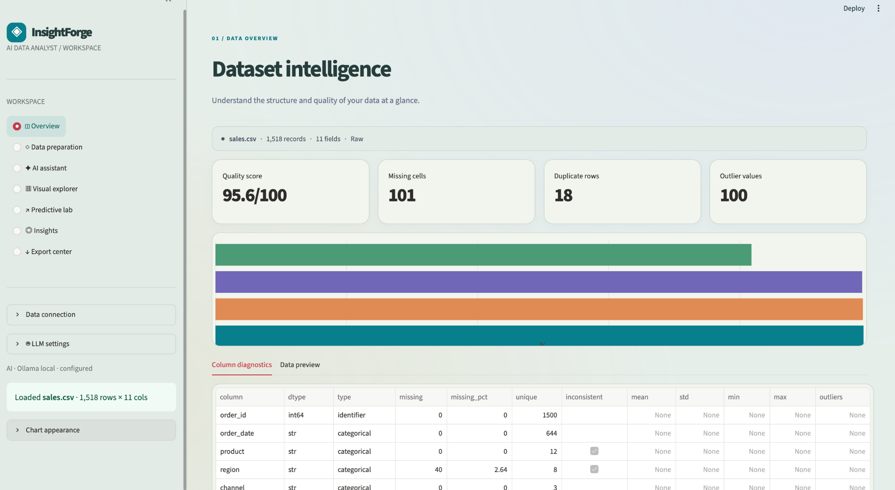

### 03 — Automated Data Preparation

Configure cleaning strategies and review a detailed transformation log with before-and-after quality scores.

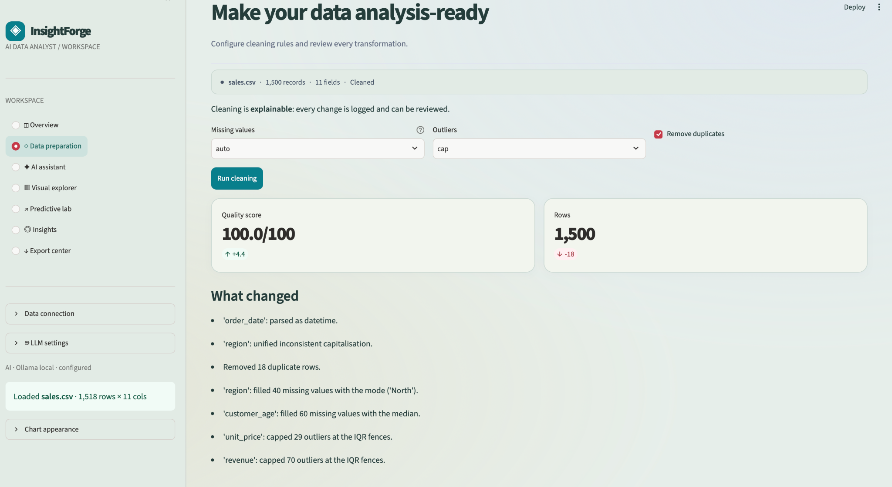

### 04 — AI Data Assistant

Interact with datasets using natural language. The assistant generates SQL queries, executes validated queries and displays analytical results.

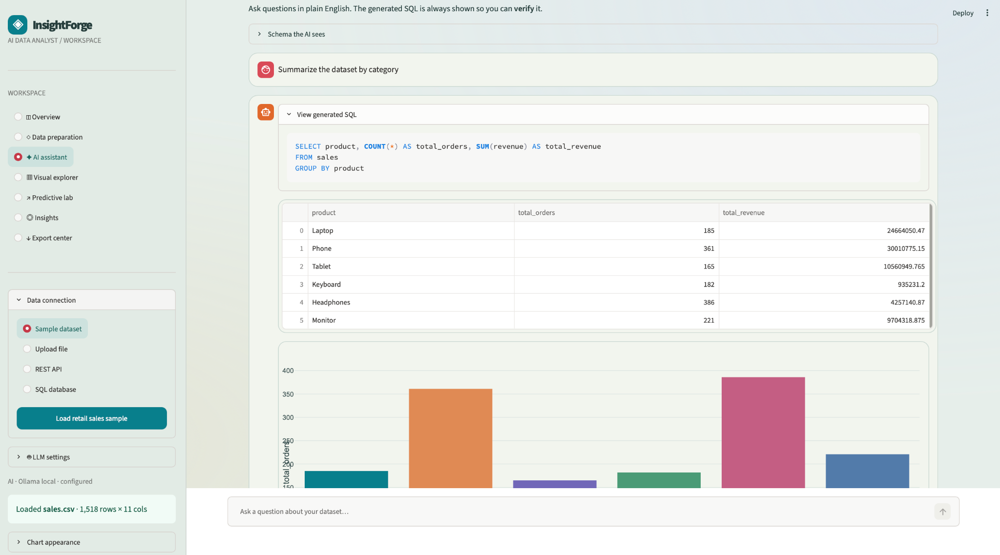

### 05 — Visual Explorer

Explore data through automatic visualizations and customizable interactive charts.

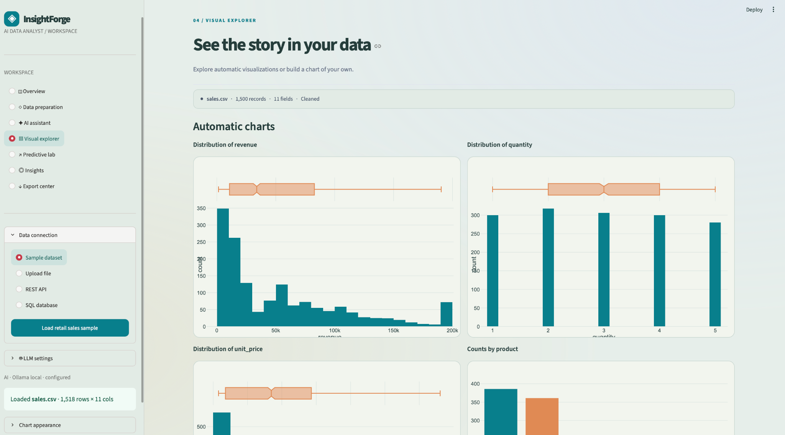

### 06 — Predictive Lab

Perform automated predictive modeling, time series forecasting and record segmentation.

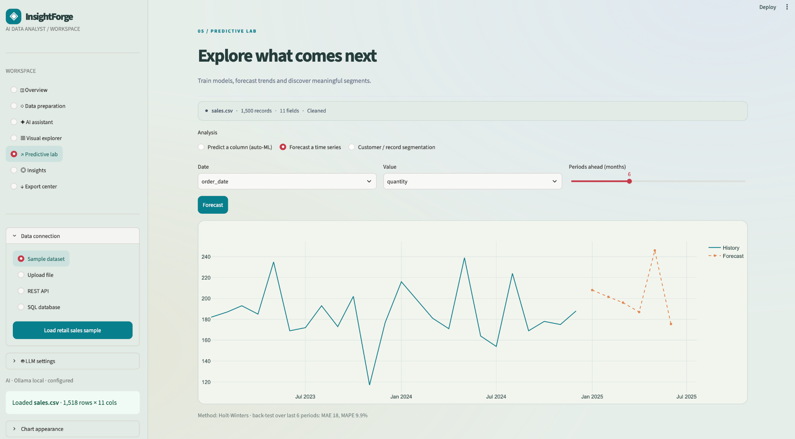

### 07 — Intelligent Insights

Discover statistically computed findings and optionally generate an AI-powered executive summary.

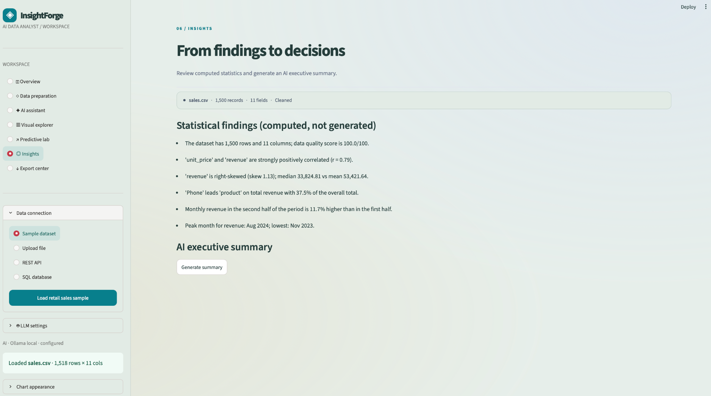

### 08 — Export Center

Download analytical reports and cleaned datasets for further analysis and presentation.

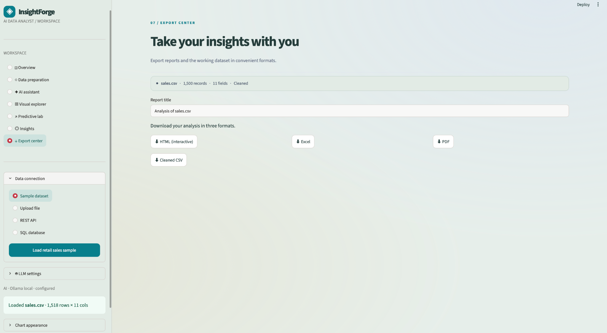

---

## 🛠️ Technology Stack

### Frontend & User Interface

| Technology | Purpose |
|---|---|
| Streamlit | Interactive web application and user interface |
| HTML | Custom interface components |
| CSS | Styling, layout and visual customization |
| Plotly | Interactive charts and analytical visualizations |

### Backend & Data Processing

| Technology | Purpose |
|---|---|
| Python | Core application logic and backend development |
| Pandas | Data manipulation, cleaning and analysis |
| NumPy | Numerical and statistical computations |
| DuckDB | In-memory analytical SQL execution |
| SQLAlchemy | SQL database connectivity |
| SQLGlot | SQL parsing and safety validation |

### Artificial Intelligence & Machine Learning

| Technology | Purpose |
|---|---|
| Ollama | Local Large Language Model execution |
| Qwen 2.5 Coder | Natural language to SQL generation |
| OpenAI API | Optional cloud-based AI integration |
| Anthropic API | Optional alternative LLM integration |
| Scikit-learn | Predictive modeling and clustering |
| Statsmodels | Statistical modeling and time series forecasting |

### Reporting & Testing

| Technology | Purpose |
|---|---|
| ReportLab | PDF report generation |
| OpenPyXL | Excel file handling and report generation |
| Pytest | Automated application testing |
| GitHub | Source code hosting and version control |
| VS Code | Development environment |

---

## 🏗️ System Architecture

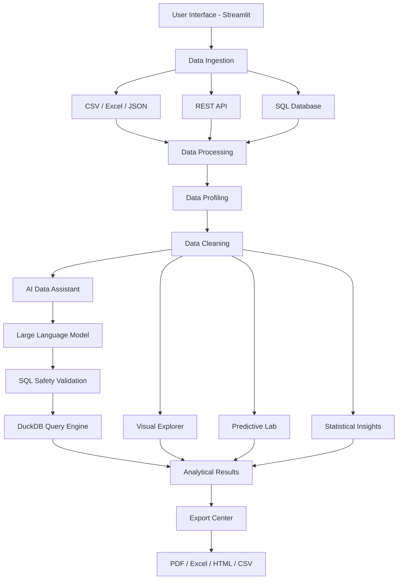

---

## ⚙️ Application Workflow

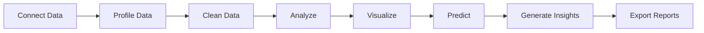

1. Connect or upload a dataset.
2. Examine data quality and structure.
3. Configure and execute data cleaning.
4. Ask analytical questions in natural language.
5. Explore interactive visualizations.
6. Perform predictive analytics.
7. Review statistical insights.
8. Download reports and cleaned datasets.

---

## 🤖 AI Data Assistant

The AI assistant allows users to interact with structured data without manually writing SQL queries.

### How It Works

1. The user enters a question in natural language.
2. Relevant dataset schema information is provided to the language model.
3. The model generates a SQL query.
4. The SQL safety module validates the query.
5. The query is executed using DuckDB.
6. Results are displayed through tables and applicable visualizations.
7. Failed queries can be retried using error feedback.

### AI Query Pipeline

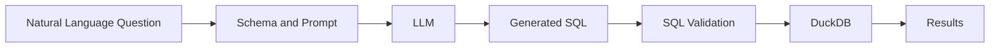

### Example

**User Question:**

> Show the total revenue generated by each product.

**Generated SQL:**

```sql
SELECT
    product,
    SUM(revenue) AS total_revenue
FROM sales
GROUP BY product
ORDER BY total_revenue DESC;
```

### Supported AI Providers

- Ollama — local model execution
- OpenAI — cloud-based language models
- Anthropic — cloud-based language models

Local Ollama integration allows supported models to run without a paid cloud API.

---

## 🧹 Data Cleaning Capabilities

The data preparation module supports:

- Missing value detection and treatment.
- Mean, median and mode imputation.
- Duplicate record removal.
- Date and data type conversion.
- Inconsistent capitalization correction.
- Outlier detection using the Interquartile Range method.
- Outlier capping or removal based on selected settings.
- Data quality score comparison.
- Explainable transformation logs.

---

## 📊 Data Visualization

InsightForge uses interactive visualizations to help users identify trends, relationships and distributions.

Supported visualization capabilities include:

- Bar charts
- Line charts
- Histograms
- Box plots
- Scatter plots
- Distribution analysis
- Correlation analysis
- Category comparisons
- Custom chart colors

---

## 📈 Machine Learning & Predictive Analytics

### Automated Machine Learning

- Target column selection
- Regression and classification workflows
- Automated model training
- Baseline model comparison
- Model performance evaluation
- Feature importance analysis

### Time Series Forecasting

- Historical trend analysis
- Holt-Winters forecasting
- Configurable forecast horizon
- Historical backtesting
- Forecast error evaluation using MAE and MAPE

### Clustering

- Unsupervised learning
- Record and customer segmentation
- Pattern identification

---

## 📋 Project Results

The following results were observed using the included retail sales sample dataset.

### Data Quality Improvement

| Metric | Before Cleaning | After Cleaning |
|---|---:|---:|
| Total Records | 1,518 | 1,500 |
| Total Columns | 11 | 11 |
| Duplicate Rows | 18 | 0 |
| Data Quality Score | 95.6/100 | 100/100 |

### Sample Analytical Findings

- The original dataset contained 101 missing cells.
- The application identified 100 potential outlier values during initial profiling.
- Duplicate records were removed during data preparation.
- Phone products contributed approximately 37.5% of total revenue.
- Unit price and revenue showed a positive correlation of approximately 0.79.
- Monthly revenue in the second half of the analyzed period was approximately 11.7% higher than in the first half.

### Sample Forecasting Results

| Metric | Observed Result |
|---|---|
| Forecasting Method | Holt-Winters |
| Forecast Horizon | 6 Months |
| Mean Absolute Error | Approximately 18 |
| Mean Absolute Percentage Error | 9.9% |

These results are specific to the demonstration dataset and selected configuration. They do not represent guaranteed performance across all datasets.

---

## 📂 Project Structure

```text
InsightForge-AI-Data-Analyst/
│
├── app.py
├── ui.py
├── requirements.txt
├── README.md
├── .env.example
├── .gitignore
│
├── modules/
│   ├── __init__.py
│   ├── ingestion.py
│   ├── profiling.py
│   ├── cleaning.py
│   ├── llm.py
│   ├── nl2sql.py
│   ├── sql_safety.py
│   ├── visualization.py
│   ├── chart_colors.py
│   ├── ml.py
│   ├── insights.py
│   ├── report.py
│   └── evaluation.py
│
├── sample_data/
│   ├── sales.csv
│   └── generate_sample.py
│
├── evaluation/
│   ├── questions_sales.json
│   └── make_questions.py
│
├── tests/
│   ├── conftest.py
│   ├── test_cleaning_profiling.py
│   ├── test_nl2sql_and_ml.py
│   └── test_sql_safety.py
│
├── docs/
│   └── REPORT_OUTLINE.md
│
└── screenshots/
    ├── homepage.png
    ├── data-overview.png
    ├── data-cleaning.png
    ├── ai-assistant.png
    ├── visualization.png
    ├── predictive-lab.png
    ├── insights.png
    └── export-center.png
```

---

## 💻 Installation & Setup

### Prerequisites

- Python
- pip package manager
- Git or GitHub ZIP download
- Ollama, if using local AI
- A modern web browser

### Step 1 — Clone the Repository

```bash
git clone https://github.com/Aryan349409/InsightForge-AI-Data-Analyst.git
cd InsightForge-AI-Data-Analyst
```

Alternatively, download the repository ZIP from GitHub and extract it.

### Step 2 — Create a Virtual Environment

```bash
python3 -m venv .venv
```

For macOS and Linux:

```bash
source .venv/bin/activate
```

For Windows:

```bash
.venv\Scripts\activate
```

### Step 3 — Install Dependencies

```bash
python -m pip install -r requirements.txt
```

### Step 4 — Configure Local AI

Download and install Ollama from:

https://ollama.com/

Download the language model:

```bash
ollama pull qwen2.5-coder:7b
```

If Ollama is not already running, start it:

```bash
ollama serve
```

Keep Ollama running while using the AI assistant.

### Step 5 — Launch InsightForge

Open another terminal, activate the virtual environment and run:

```bash
python -m streamlit run app.py
```

### Step 6 — Open the Application

```text
http://localhost:8501
```

In the application sidebar:

- Open LLM Settings.
- Select Ollama (local).
- Enter the model name: `qwen2.5-coder:7b`
- Use the local Ollama endpoint: `http://127.0.0.1:11434`

No cloud API key is required for local Ollama execution.

For cloud AI providers, configure the appropriate credentials using `.env.example` as a template. Never upload actual API keys to GitHub.

---

## 🧪 Testing & Evaluation

InsightForge includes automated tests and an evaluation framework for assessing application behavior.

### Testing Areas

- Data profiling
- Data cleaning
- SQL safety validation
- Natural language to SQL generation
- Query retry logic
- Machine learning
- Time series forecasting

Run the automated tests:

```bash
python -m pytest -q
```

### AI Evaluation Metrics

- SQL validity rate
- Query execution accuracy
- Response latency
- Performance by question difficulty

The evaluation framework supports comparison between different language models and query-generation configurations.

---

## 🔐 Security & Privacy

- SQL query validation before execution.
- Restrictions on potentially unsafe SQL operations.
- In-memory analytical query execution.
- Local AI execution option for sensitive data.
- Environment-based configuration for API credentials.
- API keys and virtual environment files excluded through `.gitignore`.

Cloud AI providers may receive dataset schema information and selected sample values. Users should avoid sending confidential information to external providers without appropriate authorization.

---

## 🌐 Potential Use Cases

| Industry | Application |
|---|---|
| Retail | Sales analysis and demand forecasting |
| Finance | Transaction analysis and financial reporting |
| Healthcare | Operational and patient data exploration |
| E-commerce | Customer segmentation and product performance |
| Education | Academic performance analysis |
| Human Resources | Employee data exploration |
| Business Intelligence | KPI monitoring and analytical reporting |
| Research | Exploratory data analysis and statistical insights |

---

## ⚠️ Current Limitations

- AI-generated SQL may occasionally be incorrect.
- Analysis currently focuses on individual datasets rather than multi-table joins.
- Local AI performance depends on available hardware and model selection.
- Large datasets may increase memory usage and processing time.
- Forecasting accuracy depends on historical data quality and patterns.
- Automated cleaning decisions should be reviewed before business use.

---

## 🔮 Future Enhancements

- Multi-table analytics and automated join generation.
- Cloud deployment using Docker or Streamlit Cloud.
- Larger dataset processing and performance optimization.
- Retrieval-Augmented Generation integration.
- Advanced AI-powered analytical agents.
- Scheduled reports and automated monitoring.
- User authentication and role-based access.
- Enhanced dashboard customization.
- Additional machine learning algorithms.

---

InsightForge extends the general AI-assisted analytics concept through its own interface, modular architecture, data quality assessment, predictive analytics, visualization customization, SQL validation and reporting capabilities.

The project also acknowledges the open-source technologies and libraries that enable modern data analytics and artificial intelligence.

---

## 🔗 Connect With Me

[](https://github.com/Aryan349409)

[](https://www.linkedin.com/in/aryanrai-dataanalyst/)

---

<div align="center">

### 🔷 InsightForge – AI Data Analyst

**From Raw Data to Intelligent Decisions**

Built with Python, Artificial Intelligence and Data Analytics.

⭐ If you find this project useful, consider starring the repository.

</div>
